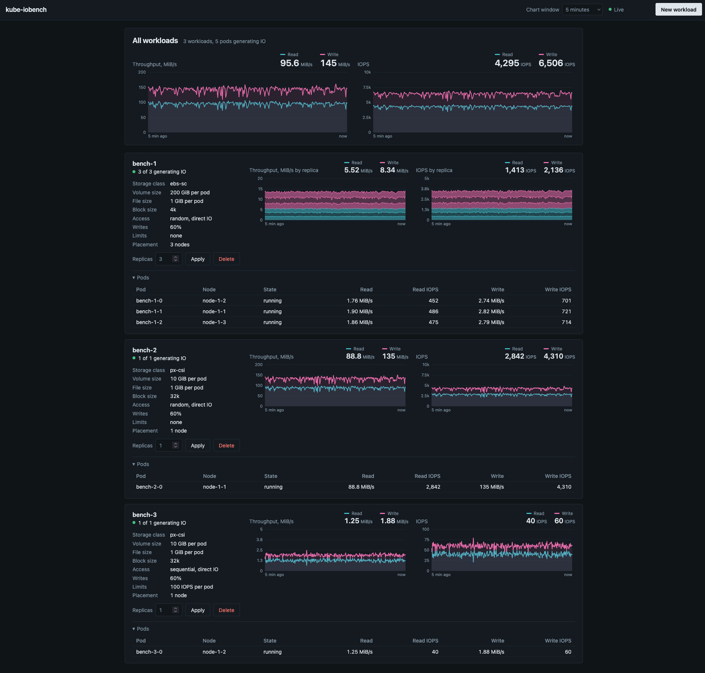

# What?

kube-iobench is a Kubernetes IO load generator. It creates StatefulSets that will provision some storage; each pod in the StatefulSet wills get its own PVC, create a file and perform random or sequential reads and writes. The read/write ratio can be specified, along with QoS parameters, block size or bypassing the page cache.

# Screenshot

